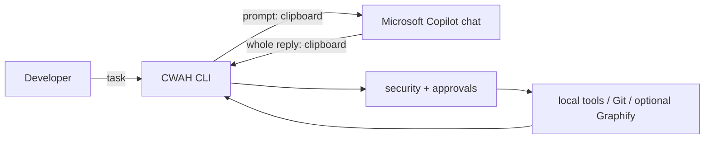

# Copilot Work Agent Harness (CWAH)

CWAH turns the normal Microsoft Copilot chat application into the reasoning side of a safe local coding loop—without a model API, authentication extraction, browser automation, or private endpoints. It selects bounded repository context, copies a durable prompt, parses Copilot's whole reply, validates requested tools, asks before changes/commands, executes locally, and sends compact results back through the clipboard.



## Install

Python 3.11+ and Git are required. With [uv](https://docs.astral.sh/uv/):

```bash
git clone https://github.com/Mark-Malysa/Copilot-Work-Agent-Harness.git
cd Copilot-Work-Agent-Harness
uv sync --extra dev
uv run cwah doctor
```

Standard pip also works: `python -m pip install .`.

## First five minutes

```powershell
cd C:\repos\your-project
cwah doctor
cwah start . --scope src\ingestion
# Task: Based on docs/ingestion-design.md implement the ingestion pipeline.
```

Paste the copied prompt into an existing/new Copilot conversation, copy its **entire** response, return, and press Enter. CWAH ignores prose/fences outside its markers. Keep using the same conversation. `--scope` prioritizes reads and is the default write boundary; repeat `--context` for supporting directories. Explicit paths in tasks receive highest retrieval priority. Graphify is optional and code-only/local; Git, ripgrep, and Python fallbacks remain usable.

Writes and commands require approval in the default `normal` mode. Secret-like/generated files are excluded. All paths are resolved against the repository (including symlinks), sessions are stored in ignored `.cwah/`, and no Copilot credentials are accessed. This is a safety aid, not a sandbox; comply with employer policy.

## Guides

[Quickstart](docs/QUICKSTART.md) · [Windows](docs/WINDOWS_SETUP.md) · [Usage](docs/USAGE.md) · [Large repositories](docs/LARGE_REPOS.md) · [Graphify](docs/GRAPHIFY.md) · [Protocol](docs/PROTOCOL.md) · [Examples](docs/EXAMPLES.md) · [Security](docs/SECURITY.md) · [Architecture](docs/ARCHITECTURE.md) · [Troubleshooting](docs/TROUBLESHOOTING.md) · [Development](docs/DEVELOPMENT.md)
