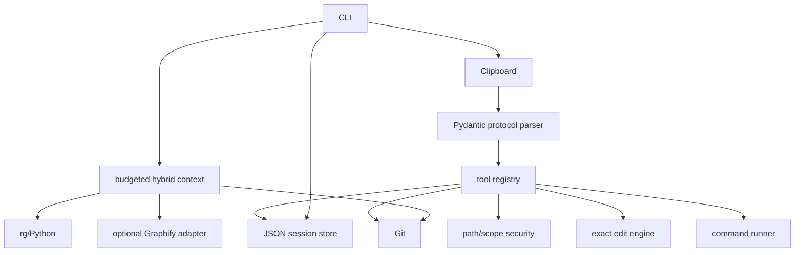
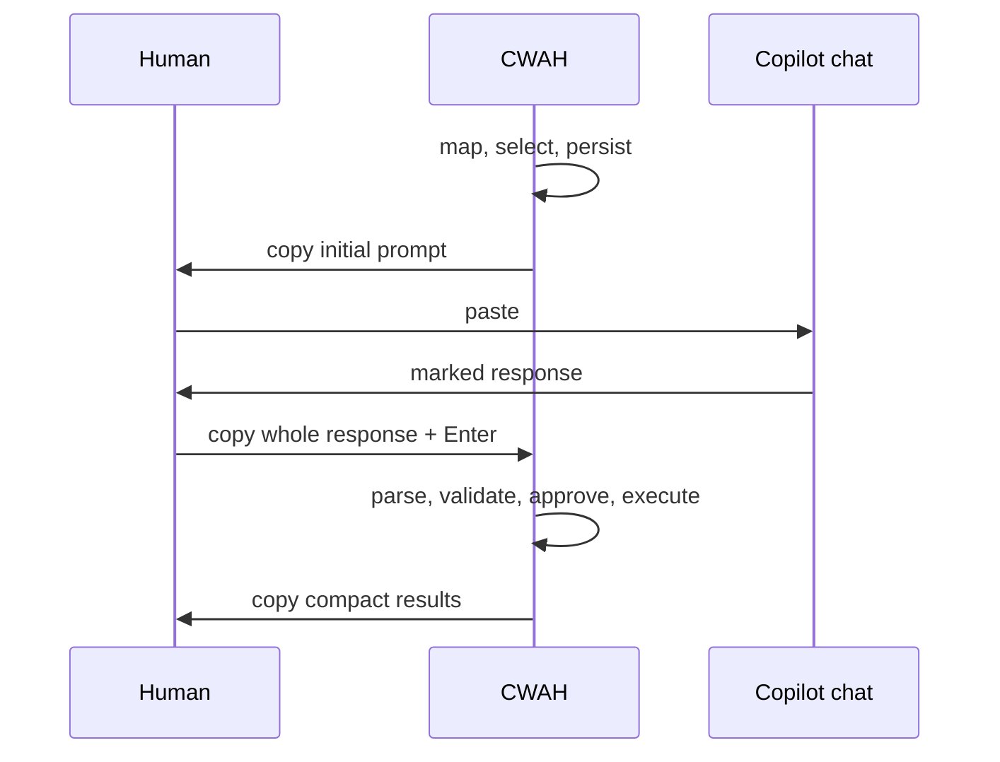

# Architecture

`config.py` loads typed `.cwah.toml`. `context/` discovers Git-visible files, explicit natural-language paths, snippets, filters, and budget omissions without wholesale reads. `protocol/` separates small validated JSON from raw payloads and builds full/follow-up/repair prompts. `security/` canonicalizes boundaries and filters secrets. `tools/` implements local reads/search/Git/Graphify, exact edits, creation/deletion, and captured commands. `agent/` persists state and drives identical real and scripted response processing. `transport/` isolates system and memory clipboards.

Large-repo performance comes from Git metadata, capped maps, targeted reads/search and a character budget—not embeddings, databases, services, or repository-wide ingestion.
