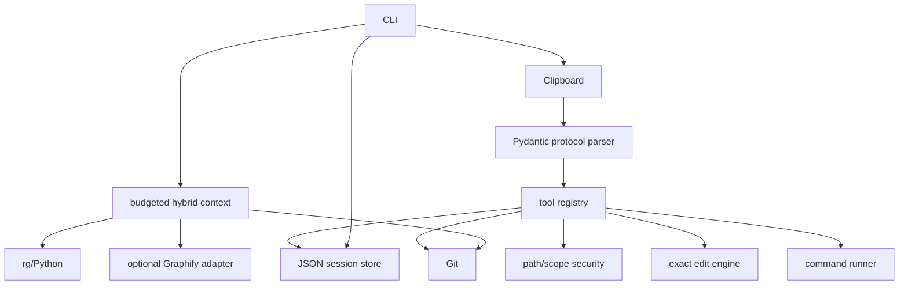
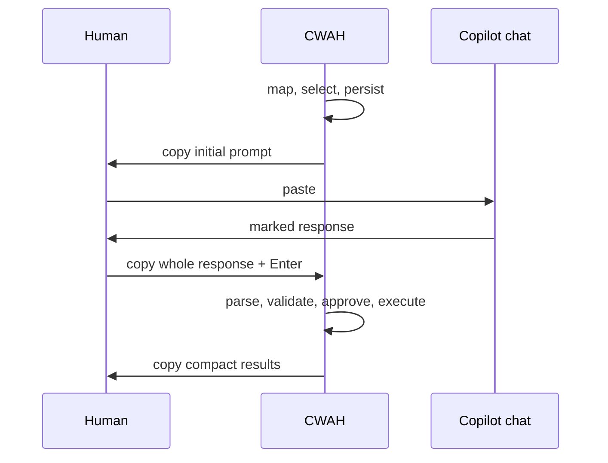

# Architecture

`config.py` loads typed `.cwah.toml`. `context/` discovers Git-visible files, explicit natural-language paths, snippets, filters, and budget omissions without wholesale reads. `protocol/` separates small validated JSON from raw payloads and builds full/follow-up/repair prompts. `security/` canonicalizes boundaries and filters secrets. `tools/` implements local reads/search/Git/Graphify, exact edits, creation/deletion, and captured commands. `agent/` persists state and drives identical real and scripted response processing. `transport/` isolates system and memory clipboards.

Large-repo performance comes from Git metadata, capped maps, targeted reads/search and a character budget—not embeddings, databases, services, or repository-wide ingestion.

## Workspace and Git boundaries

**WORKSPACE ROOT != GIT WORKTREE ROOT.** CWAH resolves the positional `REPO` argument
against the invocation directory and preserves that directory as its filesystem and security
boundary. Git's `--show-toplevel` result is recorded separately and is used only for metadata.
The Git common directory is also recorded separately because linked worktrees share it and may
have a `.git` *file*, rather than a `.git` directory.

For example, running `cwah start .` in `adb-ingestion/monday_bde` makes `monday_bde` the
workspace even when `adb-ingestion` is the Git worktree. The default scope `.` means all of
`monday_bde`; `--scope src/ingestion` narrows context/write preference within it. Sibling
directories in `adb-ingestion` are not visible. Likewise, launching against a linked worktree
uses that checkout's branch/status while its absolute common Git directory can live elsewhere.
